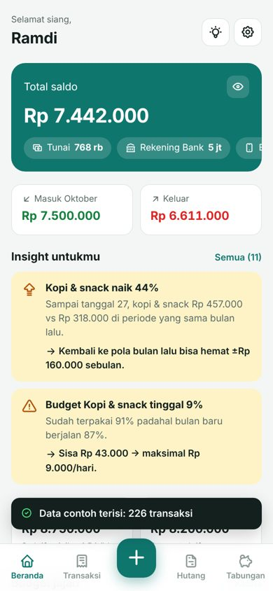
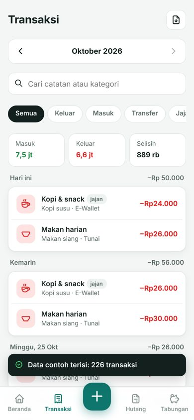
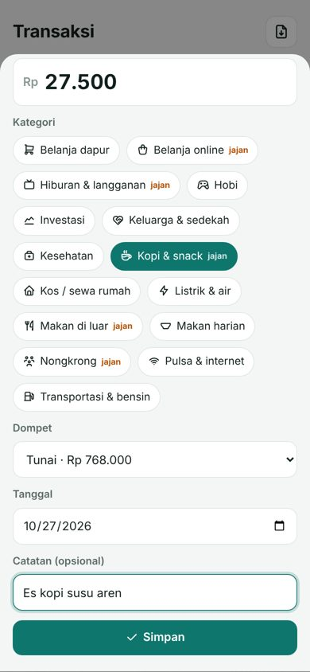
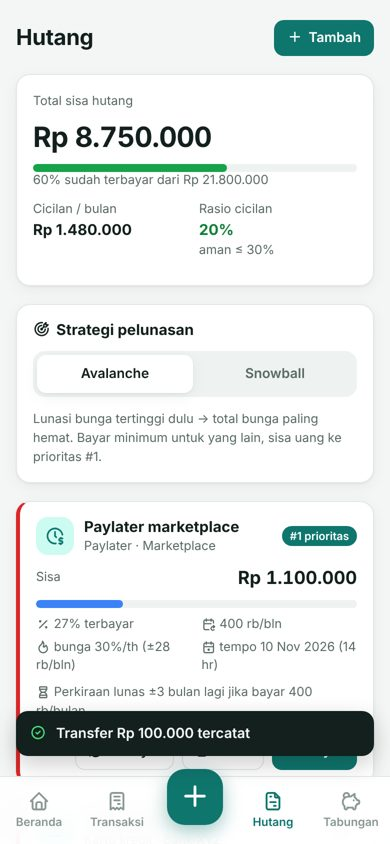
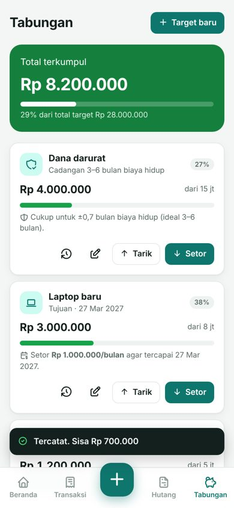
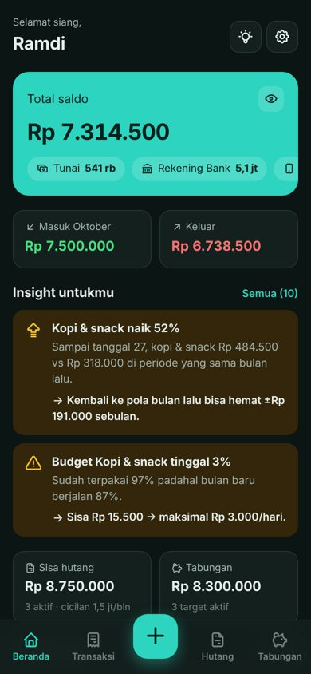
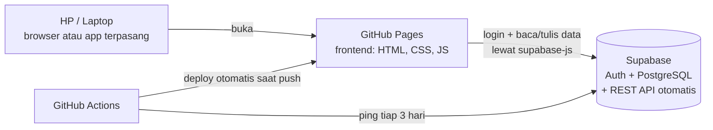

# DompetKu — Aplikasi Keuangan Pribadi (Web + HP)

Catat uang masuk & keluar, kelola hutang, target tabungan, budget jajan, dan dapatkan **insight & rekomendasi otomatis**.
Bisa dibuka kapan pun di mana pun: di browser laptop, dan di-install di HP (Android/iPhone) seperti aplikasi biasa.

**100% gratis:** tampilan di **GitHub Pages**, database + login di **Supabase (paket Free)**.

| Beranda | Transaksi | Catat | Hutang | Tabungan | Mode gelap |
|---|---|---|---|---|---|
|  |  |  |  |  |  |

---

## Daftar isi
1. [Fitur](#1-fitur)
2. [Arsitektur & struktur folder](#2-arsitektur--struktur-folder)
3. [Langkah 1 — Buat database di Supabase](#langkah-1--buat-project--database-di-supabase)
4. [Langkah 2 — Atur login (Auth)](#langkah-2--atur-login-auth)
5. [Langkah 3 — Hubungkan aplikasi ke Supabase](#langkah-3--hubungkan-aplikasi-ke-supabase)
6. [Langkah 4 — Coba di laptop (opsional)](#langkah-4--coba-di-laptop-opsional)
7. [Langkah 5 — Upload ke GitHub & online-kan](#langkah-5--upload-ke-github--online-kan)
8. [Langkah 6 — Pasang di HP](#langkah-6--pasang-di-hp)
9. [Langkah 7 — Pengamanan setelah online](#langkah-7--pengamanan-setelah-online-wajib)
10. [Perawatan rutin](#perawatan-rutin)
11. [Mengubah aplikasi](#mengubah-aplikasi)
12. [Masalah umum](#masalah-umum)

---

## 1. Fitur

| Menu | Isi |
|---|---|
| **Beranda** | Total saldo semua dompet (bisa disembunyikan), masuk/keluar bulan ini, 2 insight terpenting, ringkasan hutang & tabungan, budget jajan, transaksi terakhir |
| **Transaksi** | Catat **masuk / keluar / transfer** antar dompet, pilih bulan, filter (jajan, masuk, keluar), cari, unduh CSV |
| **Hutang** | Daftar liabilitas (cicilan, paylater, kartu kredit, pinjaman), sisa & % terbayar, bunga, jatuh tempo, **rasio cicilan**, strategi **Avalanche / Snowball**, tombol Bayar (otomatis jadi transaksi), riwayat |
| **Tabungan** | Target tabungan + **dana darurat**, progres, **saran setoran per bulan** sesuai tenggat, Setor/Tarik (otomatis jadi transaksi) |
| **Budget & jajan** | Batas bulanan per kategori, garis "posisi ideal hari ini", list jajan (frekuensi, rata-rata, proyeksi) |
| **Insight & analisis** | Semua rekomendasi, aturan **50/30/20**, tren 6 bulan, pengeluaran terbesar, tips keuangan |
| **Pengaturan** | Profil & pendapatan, kelola dompet & kategori, isi data contoh, backup JSON, ekspor CSV, reset, ganti password |

### Insight otomatis yang dihitung aplikasi (`frontend/js/insight.js`)
1. Pengeluaran melebihi pemasukan / proyeksi minus di akhir bulan + batas belanja harian
2. Aturan 50/30/20 (kebutuhan, keinginan, tabungan & cicilan)
3. Kategori yang naik ≥30% dibanding periode sama bulan lalu + potensi hemat
4. "Kebocoran" jajan kecil-kecil + proyeksi setahun
5. Budget hampir habis / terlewati / terpakai terlalu cepat
6. Rasio cicilan terhadap pendapatan (aman ≤ 30%)
7. Prioritas pelunasan hutang (Avalanche / Snowball)
8. Peringatan hutang berbunga tinggi (paylater, kartu kredit)
9. Jatuh tempo cicilan dalam 5 hari
10. Kecukupan dana darurat (ideal 3–6x biaya hidup)
11. Setoran per bulan agar target tabungan tercapai tepat waktu
12. Pengingat "bayar diri sendiri dulu" (belum menabung bulan ini)
13. Hari paling boros
14. Pengingat kalau beberapa hari lupa mencatat

---

## 2. Arsitektur & struktur folder



- **Frontend** = tampilan (folder `frontend/`). File statis, tidak butuh server, jadi bisa di GitHub Pages.
- **Backend** = Supabase. Tabel, aturan keamanan, dan logika (bayar hutang, setor tabungan) ada di database (folder `backend/supabase/`). Supabase otomatis menyediakan REST API-nya.
- **Database** = PostgreSQL di Supabase. Setiap akun hanya bisa melihat datanya sendiri (Row Level Security).

```
dompetku/
├── README.md                     ← panduan ini
├── .gitignore
├── .github/workflows/
│   ├── deploy.yml                ← upload frontend ke GitHub Pages otomatis
│   └── keep-alive.yml            ← ping Supabase tiap 3 hari (anti-pause)
├── backend/supabase/             ← BACKEND + DATABASE
│   ├── 00_SEMUA_SEKALIGUS.sql    ← gabungan 01–04 (cukup jalankan file ini)
│   ├── 01_struktur_tabel.sql     ← tabel: profil, dompet, kategori, transaksi, hutang, tabungan, dll
│   ├── 02_keamanan_rls.sql       ← Row Level Security
│   ├── 03_fungsi_view_trigger.sql← akun baru, bayar hutang, setor/tarik, saldo, ringkasan, reset, ping
│   └── 04_data_contoh.sql        ← fungsi isi data contoh 3 bulan
├── frontend/                     ← FRONTEND (yang online di GitHub Pages)
│   ├── index.html
│   ├── manifest.webmanifest      ← supaya bisa di-install di HP
│   ├── sw.js                     ← service worker (PWA)
│   ├── icons/
│   ├── css/style.css
│   └── js/
│       ├── config.js             ← ⚠️ ISI URL & KEY SUPABASE DI SINI
│       ├── app.js                ← titik awal: login, router, navigasi
│       ├── api.js                ← semua komunikasi ke Supabase
│       ├── store.js              ← data sementara (profil, dompet, kategori)
│       ├── insight.js            ← mesin insight & rekomendasi
│       ├── ui.js                 ← komponen: toast, sheet, konfirmasi, input rupiah
│       ├── util.js               ← format rupiah, tanggal
│       └── halaman/              ← beranda, transaksi, form-transaksi, hutang,
│                                    tabungan, budget, analisis, pengaturan
└── docs/tampilan/                ← screenshot
```

### Tabel database

| Tabel | Isi |
|---|---|
| `profil` | nama, pendapatan bulanan, strategi hutang |
| `dompet` | tunai / bank / e-wallet + saldo awal |
| `kategori` | kategori masuk/keluar, kelompok 50/30/20, tanda **jajan**, **batas bulanan** (budget) |
| `transaksi` | masuk, keluar, transfer |
| `hutang` + `pembayaran_hutang` | liabilitas & riwayat cicilan |
| `tabungan` + `mutasi_tabungan` | target tabungan & riwayat setor/tarik |
| View `v_saldo_dompet`, `v_ringkasan_bulanan` | saldo terkini & ringkasan per bulan |

---

## Langkah 1 — Buat project & database di Supabase

1. Buka **https://supabase.com** → **Start your project** → daftar pakai akun GitHub (paling praktis).
2. Klik **New project**:
   - **Name:** `dompetku`
   - **Database Password:** buat yang kuat, **simpan** di tempat aman
   - **Region:** pilih **Southeast Asia (Singapore)** supaya cepat dari Indonesia
   - Plan: **Free** → **Create new project**, tunggu ±2 menit.
3. Di menu kiri buka **SQL Editor** → **New query**.
4. Buka file `backend/supabase/00_SEMUA_SEKALIGUS.sql`, **copy semua isinya**, tempel ke editor → klik **Run**.
   Harus muncul `Success. No rows returned`.
5. Cek di menu **Table Editor**: harus ada tabel `profil`, `dompet`, `kategori`, `transaksi`, `hutang`, `pembayaran_hutang`, `tabungan`, `mutasi_tabungan`.

> Lebih suka bertahap? Jalankan `01` → `02` → `03` → `04` berurutan. Hasilnya sama.

---

## Langkah 2 — Atur login (Auth)

Di Supabase buka **Authentication**:

1. **Sign In / Providers → Email**: pastikan **Enable Email provider** aktif.
2. **Confirm email**: untuk pemakaian pribadi boleh **dimatikan** supaya bisa langsung masuk setelah daftar.
   Kalau tetap aktif, kamu harus klik link di email dulu sebelum bisa login.
3. **URL Configuration** (isi setelah Langkah 5 selesai, saat alamat GitHub Pages sudah ada):
   - **Site URL:** `https://USERNAME-GITHUB.github.io/dompetku/`
   - **Redirect URLs:** tambahkan juga `https://USERNAME-GITHUB.github.io/dompetku/**` dan `http://localhost:8000/**`

---

## Langkah 3 — Hubungkan aplikasi ke Supabase

1. Di Supabase buka **Project Settings → API Keys** (atau **Data API / API**).
2. Salin:
   - **Project URL** → contoh `https://abcdefghijk.supabase.co`
   - **Publishable key** (`sb_publishable_...`) — kalau belum ada, pakai **anon public** key.
3. Buka `frontend/js/config.js`, ganti dua baris ini:

```js
SUPABASE_URL: 'https://abcdefghijk.supabase.co',
SUPABASE_KEY: 'sb_publishable_xxxxxxxxxxxxxxxx',
```

> ✅ Key ini **aman** ditaruh di repo publik karena data dilindungi Row Level Security.
> ❌ **JANGAN PERNAH** isi dengan `service_role` / `secret` key — key itu bisa membuka semua data. Workflow deploy akan menolak jika kamu tidak sengaja memakainya.

---

## Langkah 4 — Coba di laptop (opsional)

Aplikasi memakai JavaScript modules, jadi **tidak bisa** dibuka dengan klik dua kali `index.html`. Jalankan server kecil:

```bash
cd frontend
python -m http.server 8000
```

Buka **http://localhost:8000** → **Daftar** → masuk → di Beranda klik **Isi data contoh** untuk melihat semua fitur & insight.

> Tidak punya Python? Pakai ekstensi **Live Server** di VS Code (klik kanan `index.html` → *Open with Live Server*).

---

## Langkah 5 — Upload ke GitHub & online-kan

### 5a. Buat repository
1. Login ke **https://github.com** → **New repository**.
2. **Repository name:** `dompetku` · **Public** (GitHub Pages gratis wajib repo publik) · **Create repository**.

### 5b. Upload file (pilih salah satu)

**Cara A — lewat Git (disarankan, sekalian belajar):**
```bash
cd dompetku
git init
git add .
git commit -m "DompetKu versi pertama"
git branch -M main
git remote add origin https://github.com/USERNAME-GITHUB/dompetku.git
git push -u origin main
```

**Cara B — GitHub Desktop:** *File → Add local repository* → pilih folder `dompetku` → *Publish repository* (hilangkan centang *Keep this code private*).

> ⚠️ Upload lewat tombol "Add file → Upload files" di web GitHub sering **tidak ikut** folder tersembunyi `.github`. Pakai Cara A/B.

### 5c. Aktifkan GitHub Pages
1. Di repo: **Settings → Pages**.
2. **Source:** pilih **GitHub Actions**.
3. Buka tab **Actions** → workflow **Deploy ke GitHub Pages** akan berjalan (kalau belum, klik *Run workflow*).
4. Setelah centang hijau, aplikasi online di:
   **`https://USERNAME-GITHUB.github.io/dompetku/`**
5. Kembali ke **Langkah 2 nomor 3** dan isi URL tersebut di Supabase.

Setiap kali kamu `git push` perubahan di folder `frontend/`, website otomatis ter-update dalam ±1 menit.

---

## Langkah 6 — Pasang di HP

- **Android (Chrome):** buka alamat aplikasi → menu **⋮** → **Instal aplikasi** / **Tambahkan ke layar utama**.
- **iPhone (Safari):** buka alamat aplikasi → tombol **Bagikan** → **Tambah ke Layar Utama**.

Ikon **DompetKu** muncul di layar utama dan terbuka layar penuh seperti aplikasi biasa. Data sama persis dengan di laptop.

---

## Langkah 7 — Pengamanan setelah online (wajib)

1. **Buat akunmu dulu** di aplikasi.
2. Lalu di Supabase **Authentication → Sign In / Providers** matikan **Allow new users to sign up**.
   Orang lain tetap tidak bisa melihat datamu, tapi ini mencegah orang asing membuat akun di project-mu.
3. Pakai password yang kuat dan berbeda dari akun lain.

---

## Perawatan rutin

| Kapan | Apa |
|---|---|
| Otomatis tiap 3 hari | GitHub Actions **Jaga Supabase tetap aktif** mem-ping database supaya project gratis tidak di-pause (pause terjadi setelah 7 hari tanpa aktivitas). |
| Tiap 60 hari | GitHub menonaktifkan jadwal workflow di repo yang 60 hari tanpa commit. Cukup buat commit kecil, atau buka tab **Actions** dan aktifkan lagi. |
| Minimal sebulan sekali | **Pengaturan → Backup semua data (JSON)**. Paket gratis Supabase tidak punya backup otomatis. Simpan di Google Drive. **Jangan** commit file backup ke GitHub (sudah dicegah `.gitignore`). |
| Kalau aplikasi tiba-tiba gagal memuat | Buka dashboard Supabase. Jika project **Paused**, klik **Restore project**. |

Batas paket Free (cek ulang di supabase.com/pricing): 2 project aktif, database 500 MB. Untuk keuangan pribadi, 500 MB cukup untuk ratusan ribu transaksi.

---

## Mengubah aplikasi

| Mau mengubah | Edit file |
|---|---|
| Warna, font, ukuran | `frontend/css/style.css` (variabel di `:root`) |
| Aturan insight / rekomendasi | `frontend/js/insight.js` |
| Kategori default akun baru | fungsi `buat_data_awal` di `backend/supabase/03_fungsi_view_trigger.sql` |
| Tampilan halaman | `frontend/js/halaman/*.js` |

Setelah mengubah file frontend, naikkan `VERSI` di `frontend/sw.js` (mis. `dompetku-v1.0.1`) supaya HP mengambil versi terbaru, lalu `git push`.
Setelah mengubah file SQL, jalankan ulang di SQL Editor (aman dijalankan ulang).

---

## Masalah umum

| Gejala | Solusi |
|---|---|
| Muncul "DompetKu belum terhubung" | `config.js` belum diisi / salah ketik URL. |
| "Database belum siap" setelah login | File SQL belum dijalankan. Ulangi Langkah 1. |
| "Email belum dikonfirmasi" | Klik link di email, atau matikan *Confirm email* (Langkah 2). |
| Link konfirmasi/reset password membuka localhost | Isi **Site URL** di Supabase (Langkah 2 no. 3). |
| "Gagal terhubung ke server" | Cek internet; cek apakah project Supabase sedang Paused. |
| Workflow deploy merah: "config.js belum diisi" | Isi `config.js` lalu push lagi. |
| Halaman 404 di GitHub Pages | Pastikan *Settings → Pages → Source = GitHub Actions* dan workflow sudah hijau. |
| Tampilan HP tidak berubah setelah update | Naikkan `VERSI` di `sw.js`, push, lalu tutup-buka aplikasi 2x. |
| Tidak bisa hapus dompet | Dompet sudah punya transaksi. Ubah dompet → hilangkan centang **Aktif**. |
| Salah catat pembayaran hutang | Menu Transaksi → ketuk transaksinya → **Hapus**. Sisa hutang otomatis kembali. |

---

Dibuat untuk pemakaian pribadi. Kode bebas diubah sesuai kebutuhan.
